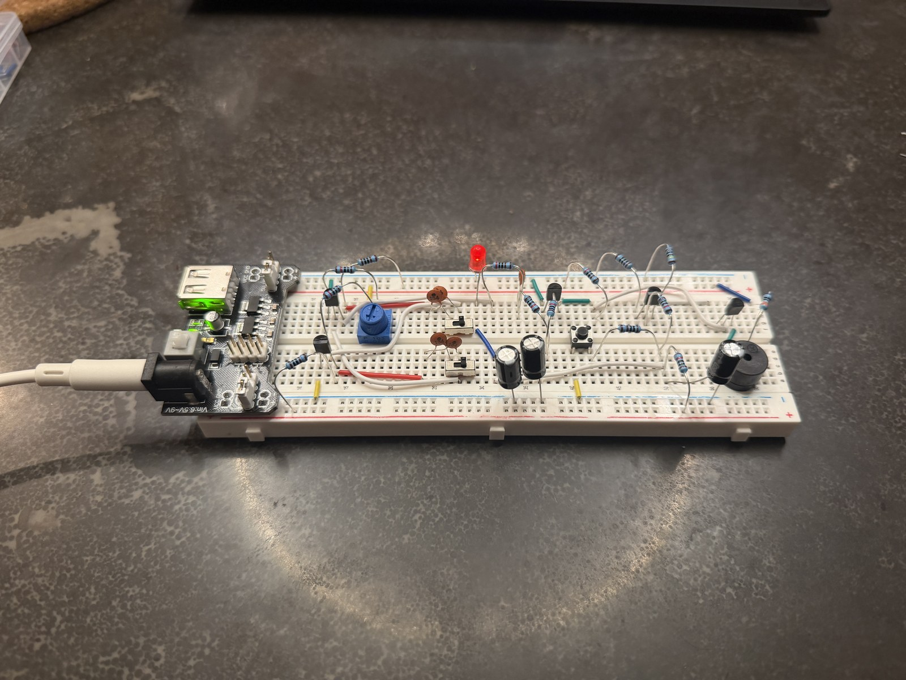
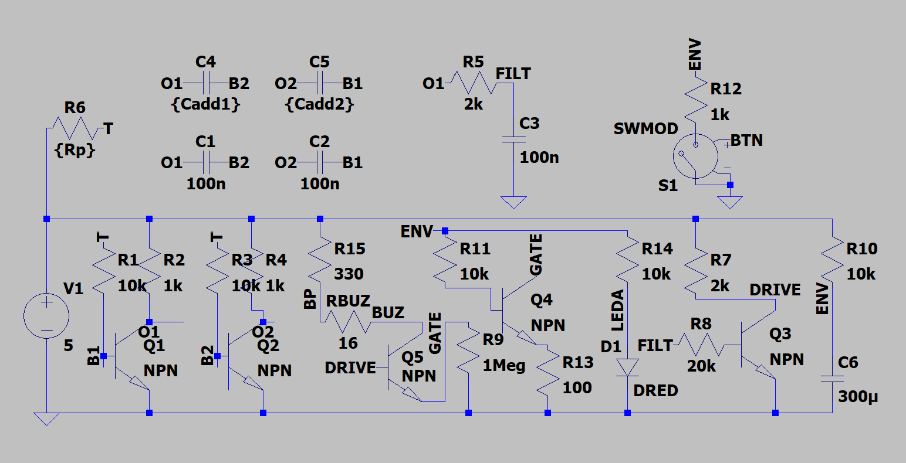
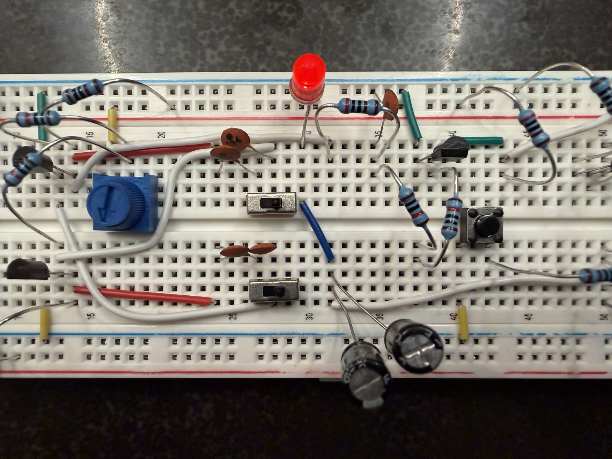
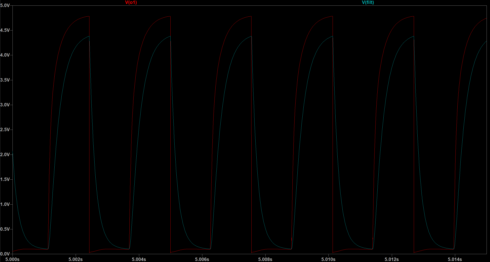
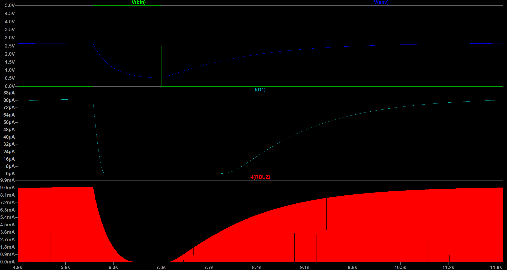
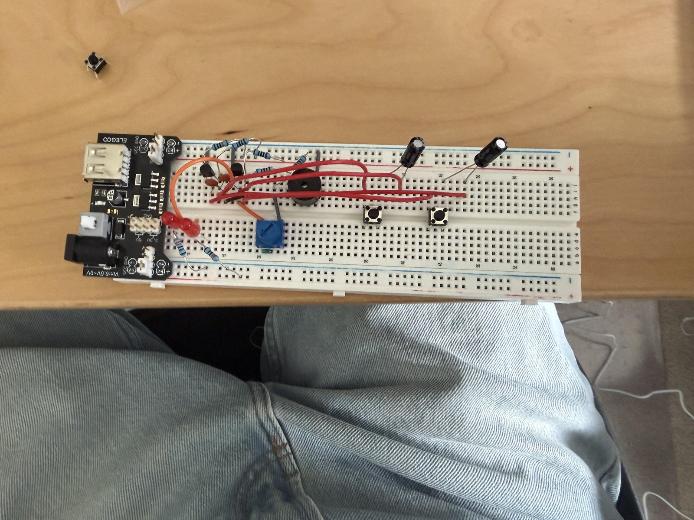

# Vision-Configured Analog Oscillator

A hand-controlled analog sound circuit with adjustable pitch and a button-controlled
fade. The breadboard and LTspice model are complete. A computer-vision phase is in
progress to read the potentiometer and switches from photographs.

## Demonstration

The potentiometer and two maintained switches change the tone. Holding the button
suppresses the buzzer and fades the LED; releasing it lets both recover.

**Hardware demonstration**

https://github.com/user-attachments/assets/6a8cb63d-4a44-4317-ac0d-6d29a920b673

**Envelope and LED close-up**

https://github.com/user-attachments/assets/1e42837d-ddef-4ed7-b5bc-d3109db0a690

Audio is amplified with peak limiting for audibility. Use the player's speaker
control to unmute. Click a photograph for the full-resolution version.

## Circuit operation

The 5 V core is a two-transistor astable multivibrator. A nominal 10 kΩ
potentiometer changes the shared timing resistance. Each switch adds 100 nF to
one side of the timing network, giving four persistent configurations with
symmetric or asymmetric waveforms.

The oscillator output passes through a 2 kΩ/100 nF low-pass filter, with a nominal
cutoff near 796 Hz. Q3 isolates this signal from the output stage; Q5 drives the
passive buzzer, and Q4 controls its emitter-return path from the envelope voltage.
The button discharges a 300 µF envelope through 1 kΩ. After release, it recharges
through 10 kΩ, restoring buzzer current and LED brightness.

The main design problem was keeping the fade circuit from loading the timing
oscillator. Earlier output-control experiments altered pitch or produced little
audible effect. The final design separates timing from the output envelope.
[Design history and modeling assumptions](docs/circuit-design.md) explain those
experiments and the original physics-class prototype.

## Simulation results

The reference run in LTspice 26.0.2 holds the button from 6–7 seconds during a
12-second transient. It predicts strong buzzer-current suppression with little
frequency change:

| Measurement | Result |
|---|---:|
| Normal buzzer RMS current | 5.441 mA |
| Held-button buzzer RMS current | 3.094 µA |
| Recovered buzzer RMS current | 5.362 mA |
| Normal oscillator frequency | 389.428 Hz |
| Held-button oscillator frequency | 389.508 Hz |
| Simulated frequency change | 0.0204% |

The filtered waveform has slower edges, lower amplitude, and phase delay.

The envelope, LED current, and modeled buzzer current fall during the button hold
and recover after release. The buzzer is modeled as a resistive load, so these
results describe electrical behavior rather than acoustic loudness.

The physical build reproduces the tone controls, LED fade, and buzzer suppression
qualitatively. Oscilloscope measurements have not yet been collected.

[Editable schematic](ltspice/analog-oscillator-v8.asc) ·
[Reference measurements](ltspice/simulation-results.txt) ·
[How to rerun and inspect the evidence](docs/verification.md)

## Computer vision

A small PyTorch CNN estimates board orientation, the two switch states, and
potentiometer center/pointer-tip positions. Its shared encoder feeds orientation
and switch heads plus keypoint heatmaps. The implementation was developed with
AI coding assistance.

The first 40-photo session exposed background-dominated heatmap loss, a
small-batch normalization mismatch, and lost switch-position information.
Spatial heatmap loss, GroupNorm, and a spatial switch head improved the fit;
the [experiment history](docs/cv-experiments.md) records the runs and results.
Evaluation so far reuses training photographs; performance on an independent
capture session remains unknown.

The [published training session](data/pilot-s01/README.md) contains all 40 processed
photos and manual labels. [Verification](docs/verification.md#computer-vision-evidence)
covers inspecting them and running the code. [Architecture and development](docs/computer-vision-plan.md)
and the [capture protocol](data/README.md) provide the technical details.

## Remaining work

- Measure physical waveforms and frequency, and calibrate potentiometer angle to resistance.
- Evaluate the existing model on a fresh `s02` validation session; reserve `s03` for the final test.
- Establish prediction acceptance thresholds and verify the switch-to-capacitor mapping.
- Connect accepted predictions and calibration to an LTspice controller. Trained weights are not published yet.

## Original prototype

The physics-class build used two alternating LEDs, a passive buzzer, one timing
potentiometer, and two momentary capacitor switches. Added capacitance lowered
the pitch far enough to make the alternating blinking visible.

https://github.com/user-attachments/assets/623c1aa6-c2fb-44d2-a902-93ec4056ba6b
